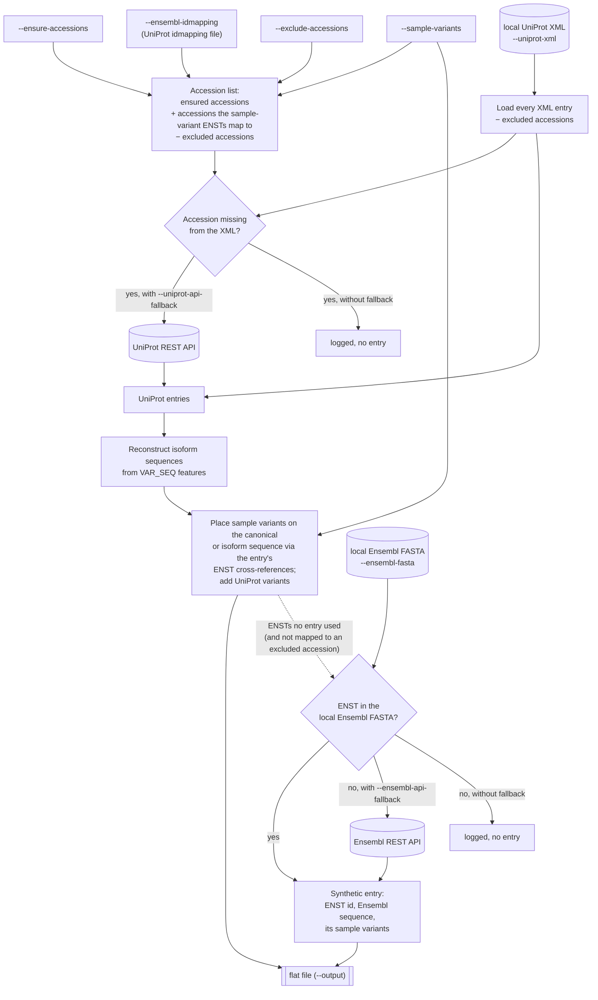

# ENST2UniProt-mapper

Builds truncated UniProt flat files as input for [ProtGraph](https://github.com/mpc-bioinformatics/ProtGraph).

The tool combines UniProt entries with sample-specific variants given per Ensembl transcript (ENST).
For each entry it writes a reduced Swiss-Prot-style record that keeps only what ProtGraph needs to build protein graphs:

- canonical sequence (`SQ`)
- isoforms (`CC -!- ALTERNATIVE PRODUCTS`, `FT VAR_SEQ`)
- variants (`FT VARIANT`): sample variants, plus UniProt's own variant annotations unless disabled

All other header lines (dates, organism, references, `MW`, `CRC64`) are fixed placeholders.
Sample-variant transcripts that no UniProt entry references get a synthetic entry built from the Ensembl protein sequence.

> [!WARNING]
> The UniProt and Ensembl REST APIs can be unreliable.
> Complete local files (UniProt XML, Ensembl FASTA) are preferable; use `--uniprot-api-fallback` and `--ensembl-api-fallback` only for the few records the local files lack.

## Contents

- [Build](#build)
- [Usage](#usage)
- [Data sources](#data-sources)
- [Workflow](#workflow)
- [Variant encoding](#variant-encoding)
- [License](#license)

## Build

```
cargo build --release
```

The binary is written to `target/release/enst2uniprot-mapper`.

## Usage

### Minimal Example

```
enst2uniprot-mapper \
  --ensure-accessions accessions.txt \
  --ensembl-idmapping HUMAN_9606_idmapping.dat.gz \
  --uniprot-xml UP000005640_9606.xml.gz \
  --ensembl-fasta Homo_sapiens.GRCh38.pep.all.fa.gz \
  --sample-variants variants.txt \
  --output protgraph_input.txt
```

### Arguments

<details>
<summary>Required arguments</summary>

| Argument | Description |
|----------|-------------|
| `--ensure-accessions <FILE>` | UniProt accessions to ensure in the output, one per line, in addition to every entry of the UniProt XML |
| `--ensembl-idmapping <FILE>` | UniProt id mapping file; links sample-variant ENSTs to UniProt accessions |
| `--uniprot-xml <FILE>` | Local UniProt XML (`.xml` or `.xml.gz`). Required unless `--uniprot-api-fallback` is set |

</details>

<details>
<summary>Optional inputs</summary>

| Argument | Default | Description |
|----------|---------|-------------|
| `--sample-variants <FILE>` | none | Sample variants per ENST. Without it, only UniProt variants are included |
| `--exclude-accessions <FILE>` | none | Canonical accessions to leave out, one per line. Applies to the ensured accessions and to the XML entries |
| `--ensembl-fasta <FILE>` | none | Local Ensembl protein FASTA (`.fa` or `.fa.gz`), source of sequences for synthetic entries |
| `--output <FILE>` | stdout | Output flat file |
| `--log-file <FILE>` | `exceptions.log` | Run log: every event, including skipped and malformed input records |

</details>

<details>
<summary>Variants and fallbacks</summary>

| Argument | Default | Description |
|----------|---------|-------------|
| `--include-uniprot-variants[=true\|false]` | `true` | Include UniProt's own variant annotations |
| `--uniprot-api-fallback[=true\|false]` | `false` | Fetch accessions missing from the UniProt XML from the UniProt REST API |
| `--ensembl-api-fallback[=true\|false]` | `false` | Fetch transcripts missing from the Ensembl FASTA from the Ensembl REST API |

</details>

<details>
<summary>REST API settings</summary>

| Argument | Default | Description |
|----------|---------|-------------|
| `--api-timeout-secs` | 30 | Timeout per request attempt |
| `--api-max-attempts` | 5 | Attempts per request, including the first |
| `--api-retry-backoff-ms` | 500 | Base backoff between attempts; doubles after each failed attempt |

</details>

### Example Input Files

<details>
<summary><code>accessions.txt</code>: UniProt accessions</summary>

One accession per line. The same format is used for `--exclude-accessions`.

```
P62258
```

</details>

<details>
<summary><code>variants.txt</code>: sample variants</summary>

One variant per line, `<ENST>[.<version>]` and `<pos><ref>><pos><alt>`, separated by whitespace.
Both positions must be equal; `ref` and `alt` may span several residues, and `*` marks a stop.
See [Variant encoding](#variant-encoding) for how each case is written.

```
ENST00000264335.13	9Y>9C
ENST00000571732.5	2V>2A
ENST00000264335.13	21DEM>21D
```

</details>

<details>
<summary><code>HUMAN_9606_idmapping.dat.gz</code>: UniProt id mapping</summary>

The UniProt id mapping file as downloaded, tab-separated `<accession>`, `<id type>`, `<id>`.
Only `Ensembl_TRS` lines are used; an isoform accession such as `P62258-2` maps to its canonical accession `P62258`.

```
P62258	UniProtKB-ID	1433E_HUMAN
P62258	Ensembl	ENSG00000108953.18
P62258-1	Ensembl_PRO	ENSP00000264335.8
P62258-1	Ensembl_TRS	ENST00000264335.13
P62258-2	Ensembl_TRS	ENST00000571732.5
```

</details>

### Example Output

<details>
<summary>Entry written for <code>P62258</code> with the variants above</summary>

`ENST00000571732.5` encodes isoform `P62258-2`, which lacks residues 1–22, so its variant lies on the isoform: position 2 of `P62258-2` is `V`, residue 24 of the canonical sequence.

```
ID   P62258                  Reviewed;         255 AA.
AC   P62258;
DT   01-JAN-1970, integrated into UTA.
DT   01-JAN-1970, sequence version 1.
DT   01-JAN-1970, entry version 1.
DE   RecName: Full=14-3-3 protein epsilon;
GN   Name=YWHAE; Synonyms=YWHAE; ORFNames=YWHAE;
OS   Autogenerated.
OC   Autogenerated.
OX   NCBI_TaxID=0000;
RN   [1]
RP   AUTOGENERATED
RA   This file was autogenerated;
RT   "This is an autogenerated file.";
RL   (er) Autogenerated.
CC   -!- CAUTION: This file was autogenerated and sequences
CC       can differ from UniProt!
CC   -!- ALTERNATIVE PRODUCTS:
CC       Event=Alternative splicing; Named isoforms=2;
CC       Name=1;
CC         IsoId=P62258-1; Sequence=Displayed;
CC       Name=SV;
CC         IsoId=P62258-2; Sequence=VSP_040621;
DR   UTA; P62258; Universal Transcript Archive
PE   4: Predicted;
KW   Generated for ProtGraph
FT   VAR_SEQ         1..22
FT                   /note="Missing (In isoform SV.)"
FT                   /evidence="ECO:0000303|PubMed:14702039, ECO:0000303|PubMed:20417184"
FT                   /id="VSP_040621"
FT   VARIANT         9
FT                   /note="Y -> C"
FT                   /id="ENST00000264335_0"
FT   VARIANT         21..23
FT                   /note="DEM -> D"
FT                   /id="ENST00000264335_1"
FT   VARIANT         P62258-2:2
FT                   /note="V -> A"
FT                   /id="ENST00000571732_0"
SQ   SEQUENCE   255 AA;  0 MW;  0000000000000000 CRC64;
     MDDREDLVYQ AKLAEQAERY DEMVESMKKV AGMDVELTVE ERNLLSVAYK NVIGARRASW
     RIISSIEQKE ENKGGEDKLK MIREYRQMVE TELKLICCDI LDVLDKHLIP AANTGESKVF
     YYKMKGDYHR YLAEFATGND RKEAAENSLV AYKAASDIAM TELPPTHPIR LGLALNFSVF
     YYEILNSPDR ACRLAKAAFD DAIAELDTLS EESYKDSTLI MQLLRDNLTL WTSDMQGDGE
     EQNKEALQDV EDENQ
//
```

</details>

Synthetic entries for unmapped transcripts have the same layout, with the ENST id as accession, protein name and gene name, and only `VARIANT` features.

### Logging

Every event is written to the log file (`--log-file`); warnings are also shown on stderr.
Skipped or dropped records are counted per stage, and the counts are printed at the end of the run.

## Data sources example (human)

| Input | Directory | File |
|-------|-----------|--------------|
| UniProt XML (`--uniprot-xml`) | [UniProt reference proteome UP000005640](https://ftp.expasy.org/databases/uniprot/current_release/knowledgebase/reference_proteomes/Eukaryota/UP000005640/) | `UP000005640_9606.xml.gz` |
| UniProt ↔ Ensembl id mapping (`--ensembl-idmapping`) | [UniProt id mapping by organism](https://ftp.uniprot.org/pub/databases/uniprot/current_release/knowledgebase/idmapping/by_organism/) | `HUMAN_9606_idmapping.dat.gz` |
| Ensembl protein FASTA (`--ensembl-fasta`) | [Ensembl human peptides](https://ftp.ensembl.org/pub/current_fasta/homo_sapiens/pep/) | `Homo_sapiens.GRCh38.pep.all.fa.gz` (not `abinitio`) |

All three are read as downloaded; `.gz` files are decompressed transparently.

## Workflow

1. **Accession list:** the ensured accessions, extended by every accession that a sample-variant ENST maps to in the id mapping, minus the excluded accessions.
2. **UniProt entries:** every entry of the local UniProt XML (minus excluded accessions) is processed.
   Accessions from step 1 that the XML lacks are fetched from the UniProt REST API with `--uniprot-api-fallback`, and only logged without it.
3. **Isoforms:** isoform sequences are rebuilt from the canonical sequence and the entry's `VAR_SEQ` features.
4. **Variants:** each entry picks up the sample variants of the ENSTs it cross-references and places them on the canonical sequence or on the referenced isoform.
   UniProt's own variants are placed on the sequence they are annotated on.
   All variants are checked against their sequence and rewritten into the [target encoding](#variant-encoding); variants that do not fit the sequence are logged and dropped.
5. **Unmapped transcripts:** sample-variant ENSTs that no entry used get a synthetic entry.
   The sequence comes from the local Ensembl FASTA, or with `--ensembl-api-fallback` from the Ensembl REST API for transcripts the FASTA lacks.
   A synthetic entry is only written if at least one of its variants fits the sequence.

Local files are always read first; the REST APIs are only queried for what the local files lack, and only when the matching fallback flag is set.

<details>
<summary>Workflow diagram</summary>



</details>

## Variant encoding

Sample variants and UniProt's own variants go through the same steps.

<details>
<summary>Input</summary>

- **Sample variants:** `<pos><ref>><pos><alt>` with 1-based positions.
  The variant spans `pos .. pos + len(ref) - 1`.
- **UniProt variants:** `VARIANT` features of the entry, with `original` as reference and `variation` as replacement.
  A feature without `original` or `variation` encodes missing sequence; a feature with several `variation`s is ambiguous, and one without a position cannot be placed; both are dropped.

</details>

<details>
<summary>Placement</summary>

- A sample variant is placed via the ENST cross-references of the entry: an ENST that references the displayed isoform (e.g. `P62258-1`) or the canonical accession goes onto the canonical sequence, an ENST that references another isoform goes onto that isoform's reconstructed sequence.
- A UniProt variant is placed on the sequence it is annotated on (`<location sequence="…">`), the canonical sequence if none is given.
- If the isoform's sequence could not be reconstructed, the variant is dropped; for a sample variant the ENST is then left to the Ensembl fallback.
- Variants of synthetic entries are placed on the Ensembl sequence of their transcript.

</details>

<details>
<summary>Checks</summary>

A variant is logged and dropped if

- `begin` lies outside the sequence, or `end` lies past its last residue,
- the reference residues before the first `*` differ from the sequence at `begin`,
- a `*` in the reference does not sit right after the last residue (position `length + 1`, the stop codon); e.g. `254N*>254K` on a 255-residue sequence, whose position 255 holds `Q`,
- a replacement is given without a reference,
- it still contains residues other than amino acid one-letter codes after the rewrites below (safety net, `VALIDATION SAFETY NET` in the log).

</details>

<details>
<summary>Rewrites</summary>

`Missing` means the span is deleted.
All examples are on the canonical sequence of P62258 (255 residues, ending in `…VEDENQ`).

| Case | Input | Output position | Output note |
|------|-------|-----------------|-------------|
| Substitution | `9Y>9C` | `9` | `Y -> C` |
| Several residues | `21DEM>21D` | `21..23` | `DEM -> D` |
| Deletion (`del`) | `12K>12del` | `12` | `Missing` |
| Deletion (empty replacement) | `13L>13` | `13` | `Missing` |
| Stop gained | `250V>250*` | `250..255` | `Missing` |
| Stop gained after new residues | `250VE>250K*` | `250..255` | `VEDENQ -> K` |
| `*` inside the replacement | `250V>250W*Y` | `250..255` | `VEDENQ -> W` |
| Stop lost | `255Q*>255K` | `255` | `Q -> K` |
| Stop lost, extension | `255Q*>255QGG*` | `255` | `Q -> QGG` |
| Stop lost, reference only `*` | `256*>256GGS*` | `255` | `Q -> QGGS` |
| No change | `241EQ>241EQ` | `241..242` | `EQ -> EQ` |

Rules behind the table:

- **Stop gained** (`*` in the replacement): everything after the stop is lost, so the span is extended to the end of the sequence and the replacement is cut at the first `*`.
  Residues after that `*` (`Y` in `W*Y`) are dropped, and the case is noted in the log.
- **Stop lost** (`*` in the reference): the `*` must be at `length + 1`, so the span ends at the last residue; the replacement is written up to its own first `*`.
- **Stop lost, reference only `*`:** the variant begins at `length + 1`, where there is no residue to anchor on, so the extension is anchored on the last residue.
- **Missing sequence:** `del`, an empty replacement and a stop gained without new residues all become `Missing`.
- After a stop rewrite, the reference is taken from the sequence over the new span, so reference and span always match.

</details>

<details>
<summary>Merging</summary>

Variants that are identical after the rewrites (same isoform, span, reference and replacement) are written once, with their ids joined by `_`.
This applies within the sample variants (`250V>250*` and `250VEDENQ>250*` both become `250..255 Missing`, id `ENST00000264335_4_ENST00000264335_11`) and between sample and UniProt variants.

</details>

<details>
<summary>Output</summary>

Each variant becomes one `FT VARIANT` feature:

```
FT   VARIANT         <begin>[..<end>]            canonical sequence
FT   VARIANT         <isoform>:<begin>[..<end>]  isoform, e.g. P62258-2:2
FT                   /note="<ref> -> <alt>"      or /note="Missing"
FT                   /id="<id>"
```

- **Sample variant ids** are `<ENST>_<n>`: the ENST without its version, and `n` the variant's position among that transcript's variants in the input file, counted from 0. Lines that cannot be parsed are not counted.
- **UniProt variant ids** are the feature ids (e.g. `VAR_012345`).

</details>

## License

This project is licensed under the [Apache License 2.0](LICENSE).

It produces input for [ProtGraph](https://github.com/mpc-bioinformatics/ProtGraph), a separate project by the Medizinisches Proteom-Center, Ruhr University Bochum, released under the [BSD 3-Clause License](https://github.com/mpc-bioinformatics/ProtGraph/blob/master/LICENSE).
No ProtGraph code is included in this repository.

The generated flat files are derived from UniProt data, which is available under the [Creative Commons Attribution 4.0 International (CC BY 4.0)](https://www.uniprot.org/help/license) license.
